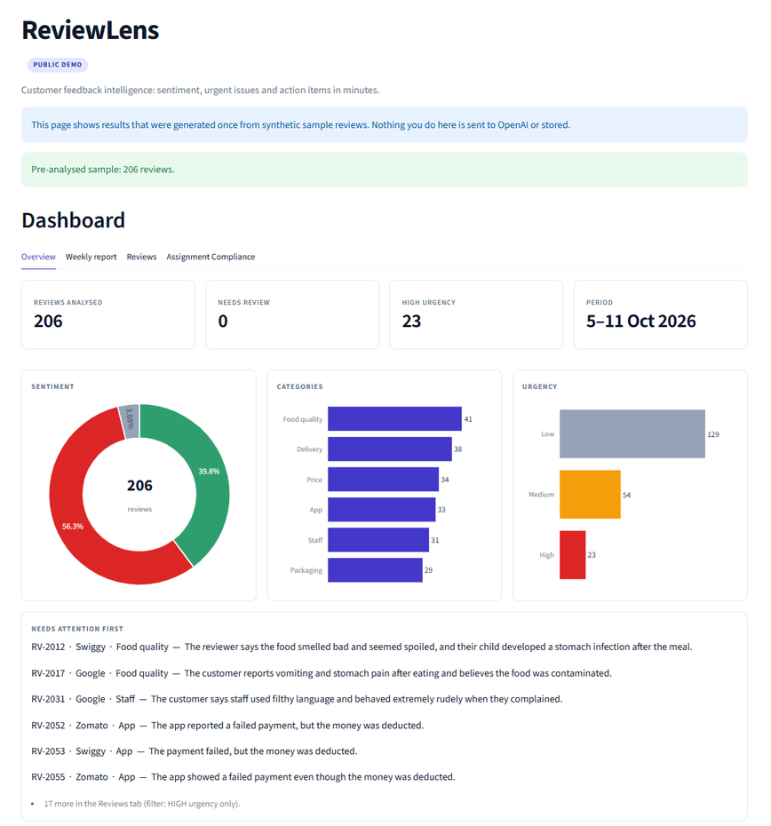

# ReviewLens — Customer Feedback Analyzer

Turn a week of customer reviews into sentiment, categories, urgent issues and three concrete action items,
in about five minutes of reading time.

Upload a CSV of reviews from platforms such as Google, Zomato, Swiggy and Amazon. ReviewLens classifies each
review with a structured LangChain pipeline (English, Tamil and Tanglish), computes exact metrics in pandas,
and has a second LangChain chain write a short, evidence-grounded management report.

> Built for the **Social Eagle AI Academy, Track 1 (Gen AI / LangChain)**, using agentic coding with Claude Code.
> Claude Code was the development tool; LangChain is the application's runtime framework.

## Live

| | |
|---|---|
| **Public demo** (no login, pre-analysed sample, no AI calls) | https://reviewlens.arunsrinivasan.io |
| **Private live analysis** (password protected, real OpenAI analysis) | https://reviewlens-admin.arunsrinivasan.io |
| **Source code** | https://github.com/arun-srinivasan-builds/review-lens |

The public demo shows a pre-analysed week of 206 synthetic reviews: dashboard, charts, top complaints, top
praise, action items, a filterable review table and a recorded **Quality & Validation** snapshot. Nothing you
do there is sent to OpenAI. The private site needs a password because it accepts uploads and calls OpenAI.



*The public demo's Overview tab: 206 pre-analysed synthetic reviews.*

## What it does

1. **Upload and validate** a CSV (`review_id, date, platform, rating, review_text`). Size, row, header,
   encoding, rating, date and ID checks run before any model call. Empty review text is dropped and counted.
2. **Classify every review** with a LangChain `ChatPromptTemplate | llm.with_structured_output(...)` chain
   returning a Pydantic model with enforced values:
   `sentiment` (positive, neutral, negative), `category` (food_quality, delivery, price, staff, packaging, app),
   `urgency` (low, medium, high), `language`, an English one-sentence `summary` and a `suggested_reply`.
3. **Retry safely.** Invalid structured output and temporary provider errors are retried a bounded number of
   times; anything unresolved is marked `needs_review` with the original text preserved and is never counted
   as analysed.
4. **Aggregate exactly.** Counts and percentages come from pandas, never from the model.
5. **Write the weekly report** with a second chain (map, then reduce): top complaints, top praise, the urgent
   items and exactly three action items. Numbers in the narrative are checked against the computed metrics.
6. **Explore and export.** Charts, HIGH-urgency filter, search and filters, and an Excel-safe UTF-8 CSV.

### Reply language

Suggested replies are drafts for human review and are never sent automatically.

| Review language | Suggested reply |
|---|---|
| English | English |
| Tamil script | Tamil |
| Tanglish (romanised Tamil) | Tanglish |
| Uncertain or mixed | English |

Summaries are always English.

## Architecture

```
                 CSV upload
                     │
        ┌────────────▼────────────┐
        │  validation.py          │  size · rows · headers · encoding · ratings · dates
        └────────────┬────────────┘
                     │ valid rows
        ┌────────────▼────────────┐
        │  classification.py      │  LCEL chain.batch(max_concurrency) → Pydantic ReviewAnalysis
        │  bounded retry          │  invalid output / temporary error → retry → needs_review
        └────────────┬────────────┘
                     │ EnrichedReview[]
        ┌────────────▼────────────┐        ┌──────────────────────┐
        │  aggregation.py         │───────▶│  report.py           │  second LCEL chain
        │  pandas: exact metrics  │ metrics│  evidence + metrics  │  → WeeklyReport (3 actions)
        └────────────┬────────────┘        └──────────┬───────────┘
                     └──────────────┬─────────────────┘
                        ┌───────────▼───────────┐
                        │  Streamlit dashboard  │  charts · filters · report · CSV export
                        └───────────────────────┘
```

| Layer | Choice |
|---|---|
| UI | Streamlit |
| Orchestration | LangChain (`langchain-core`, `langchain-openai`), LCEL |
| Structured output | Pydantic v2 + `with_structured_output()` |
| LLM | OpenAI via `ChatOpenAI`, behind a provider factory in `reviewlens/llm.py` |
| Data | pandas |
| Charts | Plotly |
| Packaging | Docker; Traefik reverse proxy in production |
| Tests | pytest with a mocked LLM |

No database, no accounts: uploads live only in the Streamlit session.

## Safeguards

| Area | Control |
|---|---|
| Secrets | API key only from environment or `.env` (git-ignored), held as a secret type, redacted from logs and errors, never shown in the UI |
| Uploads | `.csv` only, size and row caps, strict headers and UTF-8, rating and date validation, extra columns discarded |
| Prompt injection | Review text is untrusted data inside delimiters, angle brackets are neutralised, output is schema-validated, and review instructions are never followed |
| Reliability | Bounded concurrency, request timeout, bounded retries, early stop on fatal provider errors (bad key or model) |
| Metrics integrity | Counts come from pandas; narrative numbers not present in the metrics or evidence are rejected |
| Export | Formula-injection protection (`=`, `+`, `-`, `@`), UTF-8 with BOM for Excel |
| Privacy | No review text or keys in logs, no persistence, LangSmith tracing forced off, provider disclosure in the UI |
| Production | Containers run read-only, non-root, all capabilities dropped; the public demo container never receives the API key |

This is a single-user tool. If deployed publicly with sensitive customer data, put access control in front of
it (the production setup does this with a password on the live site).

## Quality and validation

Latest recorded run, measured on the public tree at commit
[`39e35a7`](https://github.com/arun-srinivasan-builds/review-lens/commit/39e35a7) with outbound network
connections blocked:

| Check | Result |
|---|---|
| Full automated test suite | **220 passed** |
| Invalid-LLM retry tests | **22 passed** |
| Ruff static checks | Passed |
| Real OpenAI calls during tests | **0** |
| Production code changes needed for the retry tests | **0** |

The retry suite covers an invalid category, sentiment or urgency followed by a valid response, persistent
invalid data stopping at the configured limit (`needs_review`), temporary errors bounded by the configured
policy, and a single failing review being isolated and excluded from aggregation. The public demo's
**Assignment Compliance** tab maps the academy brief to evidence (mandatory items, stretch goals, submission
steps) and lists these engineering results under *Additional Engineering Validation*. It is a recorded
snapshot, not live monitoring.

```bash
pip install -r requirements-dev.txt
ruff check .
pytest -v
```

## Quick start

```bash
git clone https://github.com/arun-srinivasan-builds/review-lens.git
cd review-lens
python -m venv .venv
.venv\Scripts\activate          # macOS/Linux: source .venv/bin/activate
pip install -r requirements.txt
copy .env.example .env          # macOS/Linux: cp .env.example .env
```

Edit `.env` and set `OPENAI_API_KEY` and `OPENAI_MODEL` (a chat model that supports structured output), then:

```bash
streamlit run app.py
```

Try it with `sample_data/sample_reviews.csv` (3 reviews) or `sample_data/reviews_200plus.csv` (211 rows: 206
valid, 5 deliberately invalid; English, Tamil and Tanglish, with injection and formula-like cases).

To preview the public demo mode locally, set `REVIEWLENS_MODE=demo` and run the same command.

### CSV format

```csv
review_id,date,platform,rating,review_text
R-1041,2026-10-03,Zomato,5,"Biryani was amazing, packing also neat. Will order again!"
R-1042,2026-10-03,Swiggy,1,"Ordered at 8pm, came at 9:10. Food fully cold. Very bad."
R-1043,2026-10-04,Google,2,"Saapadu nalla irundhuchu but bill la extra charge pottanga"
```

Dates are `YYYY-MM-DD`, ratings 1–5. Rows with empty text are dropped and counted; rows with invalid dates,
IDs or ratings are rejected with a reason and a CSV line number.

### Sample input and output

Three reviews from `sample_data/reviews_200plus.csv` (English, Tamil and Tanglish):

```csv
review_id,date,platform,rating,review_text
RV-2012,2026-10-10,Swiggy,1,My child fell sick with stomach infection after this meal. Food was spoiled and smelled bad.
RV-2005,2026-10-10,Zomato,5,"சாப்பாடு மிகவும் சுவையாக இருந்தது, பிரியாணி அருமை."
RV-2007,2026-10-09,Zomato,5,"Combo offer worth ah irukku, price reasonable."
```

**Output A: one analysed record per review** (from `demo_data/enriched.csv`). The Tamil review gets an English
summary and a Tamil reply; the Tanglish review gets a Tanglish reply:

```json
[
  {
    "review_id": "RV-2012",
    "sentiment": "negative",
    "category": "food_quality",
    "urgency": "high",
    "language": "English",
    "summary": "The reviewer says the food smelled bad and seemed spoiled, and their child developed a stomach infection after the meal.",
    "suggested_reply": "We’re very sorry to hear this and hope your child is feeling better. Please contact us with more details so we can look into your food safety concern."
  },
  {
    "review_id": "RV-2005",
    "sentiment": "positive",
    "category": "food_quality",
    "urgency": "low",
    "language": "Tamil",
    "summary": "The food was very tasty, and the biryani was excellent.",
    "suggested_reply": "சாப்பாடு மிகவும் சுவையாக இருந்தது என்றும் பிரியாணி அருமையாக இருந்தது என்றும் தெரிவித்ததற்கு நன்றி!"
  },
  {
    "review_id": "RV-2007",
    "sentiment": "positive",
    "category": "price",
    "urgency": "low",
    "language": "Tanglish",
    "summary": "The customer feels the combo offer is worthwhile and reasonably priced.",
    "suggested_reply": "Combo offer worth-a irukku, price reasonable-a irukku nu sonnadukku nandri!"
  }
]
```

**Output B: weekly insights report** for the full 206-review week (from `demo_data/report.json`; every number
is calculated in pandas, including the complaint breakdown):

```text
WEEKLY FEEDBACK REPORT | 2026-10-05 to 2026-10-11
Total analysed reviews: 206
Positive: 39.8% | Neutral: 3.9% | Negative: 56.3%

TOP 3 COMPLAINTS
1. Food safety concerns are the most serious: customers describe spoiled or stale food, food poisoning symptoms, and a cockroach in a meal.
2. Order accuracy creates safety risks: customers report receiving non-vegetarian food instead of vegetarian orders and a dessert containing an allergen.
3. Payment and refund problems frustrate customers: payments were deducted despite failed transactions, and some refunds remain outstanding.

COMPLAINT BREAKDOWN (calculated from analysed reviews)
1. App: 24 negative reviews (20.7% of negative), most from Swiggy (9), 7 high urgency
2. Price: 22 negative reviews (19.0% of negative), most from Google (7), 3 high urgency
3. Delivery: 21 negative reviews (18.1% of negative), most from Amazon (8), 3 high urgency

TOP PRAISE
- Customers praise tasty, fresh food, especially the biryani.
- Customers appreciate fast, on-time delivery and polite delivery partners.
- Positive feedback also highlights friendly, attentive staff and an easy-to-use app with reliable tracking.

URGENT
23 reviews require attention
Urgently investigate food safety reports and strengthen checks to prevent contaminated food and orders containing the wrong meal or allergens from reaching customers.

ACTION ITEMS
1. Inspect food handling, storage, and preparation practices, and investigate the reported illness and contamination concerns.
2. Add a final order check for vegetarian requests and allergy notes before dispatch, confirming the meal and its ingredients match the order.
3. Reconcile failed-payment deductions and overdue refunds, then resolve affected customer cases and improve payment and refund follow-up.
```

The complaint breakdown, totals, percentages and urgent counts are calculated in pandas per complaint
category, including the most-affected platform. The complaint themes themselves are written by the model
from the analysed reviews. The CSV has no time of day, so no time-slot pattern is reported.

### Configuration

| Variable | Default | Purpose |
|---|---|---|
| `LLM_PROVIDER` | `openai` | Only `openai` is implemented |
| `OPENAI_API_KEY` | — | Required for live analysis |
| `OPENAI_MODEL` | — | Required for live analysis |
| `OPENAI_TEMPERATURE` | unset | Optional. Unset sends no temperature, because some models reject non-default values |
| `MAX_UPLOAD_MB` | `10` | Maximum CSV size |
| `MAX_ROWS` | `5000` | Maximum rows per upload |
| `MAX_REVIEW_CHARS` | `2000` | Maximum characters per review |
| `MAX_CONCURRENCY` | `5` | Parallel model calls |
| `LLM_TIMEOUT_SECONDS` | `60` | Per-request timeout |
| `MAX_RETRIES` | `2` | Retries for invalid or temporary failures |
| `REVIEWLENS_MODE` | `live` | `live` (upload + OpenAI) or `demo` (pre-analysed bundle, no API calls) |

## Deployment

One Docker image runs in two modes behind an existing Traefik reverse proxy:

| Hostname | Mode | Access |
|---|---|---|
| `reviewlens.arunsrinivasan.io` | `demo` | public, no key in the container |
| `reviewlens-admin.arunsrinivasan.io` | `live` | HTTP basic auth, 12 MB request cap |

Full runbook: [`docs/DEPLOY.md`](docs/DEPLOY.md). Regenerate the demo bundle with
`python -m scripts.build_demo` (one model call per review plus one for the report).

## Repository layout

```
app.py                  Streamlit entrypoint (live and demo modes)
reviewlens/             validation, classification, aggregation, report, export, demo, llm, config, security
ui/                     dashboard, theme, quality tab
scripts/build_demo.py   builds the pre-analysed demo bundle
demo_data/              pre-analysed bundle served by the public demo
sample_data/            sample and 200+ row test CSVs
tests/                  pytest suite (LLM mocked)
docs/DEPLOY.md          VPS deployment runbook
PRPs/                   implementation blueprint used to build the app
Dockerfile, docker-compose.yml
```

## Known limitations

- Single-user, session-only: no accounts, history or database.
- One LLM provider (OpenAI). The factory in `reviewlens/llm.py` is the extension point for others.
- Without a pinned temperature, a borderline review can be classified differently between runs. Totals and
  charts are always consistent within a run, because every figure is computed from that run's rows.
- Tamil and Tanglish quality depends on the configured model; review a sample before relying on it.
